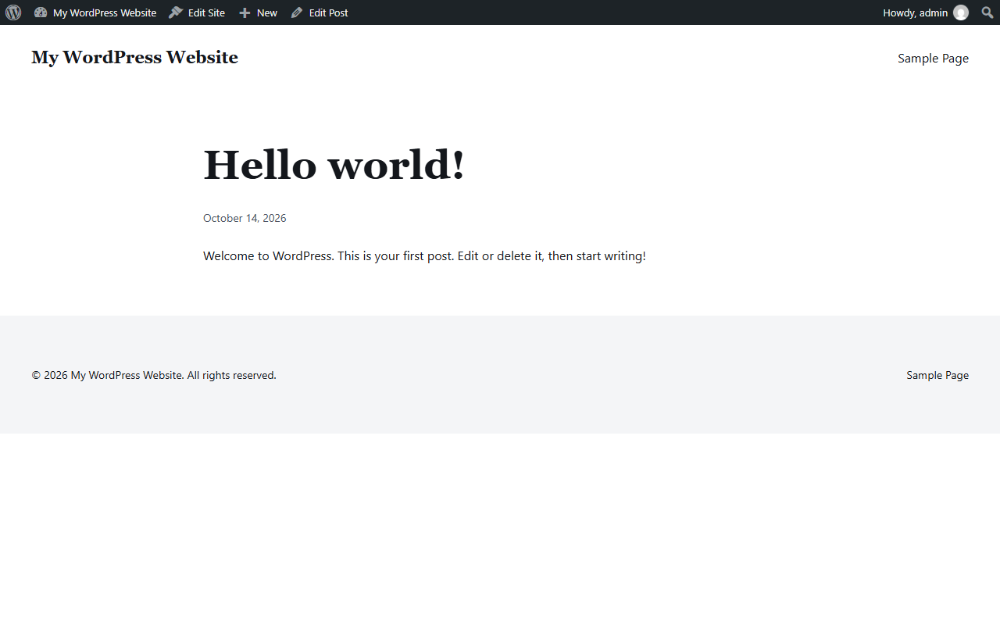

# AJR Starter Theme

The theme half of the AJR Starter Kit: a full-site-editing WordPress block theme scaffold. `theme.json` is the design system, every section is a real core block, and the client can edit everything in the Site Editor. It pairs with [AJR Starter Core](https://github.com/andrew-ajrwebdesign/ajr-starter-core), the plugin that holds everything which must survive a theme change.

[](https://playground.wordpress.net/?blueprint-url=https://raw.githubusercontent.com/andrew-ajrwebdesign/ajr-starter-theme/main/blueprint.json)

The Playground link installs this theme and the core plugin from GitHub into a throwaway WordPress in your browser. Nothing to install.



## The rules it is built on

1. **`theme.json` is the design system.** Colours, type scale, spacing and layout widths are tokens there: an 8-colour palette, 2 font families, 5 font sizes and 7 spacing steps. The stylesheet is nearly empty and holds only what `theme.json` can't express. Colours are never hex in CSS. They come through `var(--wp--preset--color--*)` or a `color-mix()` derived from a token.
2. **Real blocks only.** Every section is core block markup that opens and edits in the Site Editor. There are no shortcodes, no HTML blobs in Custom HTML blocks and no PHP-rendered layout. Core blocks come first; a custom block is an explicit decision and lives in the core plugin, so it survives a theme change.
3. **Patterns hold content, templates hold structure.** Templates are thin and compose patterns. Copy of any kind lives in a pattern as block content, so it can be translated and edited, and is never a string baked into a template.
4. **Semantic landmarks from block settings.** `<header>`, `<main>`, `<footer>` and `<article>` come from template-part and Group `tagName` settings rather than wrapper HTML. Every group carries a `metadata.name`, so the List View says "Post" or "Site header" instead of "Group".
5. **Editor parity.** The editor loads the same styles as the front end, so what the client sees while editing is what ships.
6. **Nothing typed twice.** The asset version is read from the `style.css` header, and the copyright year is rendered. A value that is typed twice drifts out of sync.

## What is in it

```
theme.json          the design tokens and element/block styles
templates/          index, single, page, archive, search, 404
parts/              header, footer
patterns/           nav, blog list, single post, posts heading, 404 content, footer content
assets/css/app.css  the few rules theme.json cannot express (sticky header, whole-card links)
functions.php       setup: editor styles, pattern category, version from the header
```

## Starting a project from it

1. Copy the repo (use it as a template, or `git clone` and then delete `.git`).
2. Rename it with these five replacements, then rename the folder:

   | Find | Replace with | What it is |
   |---|---|---|
   | `AJR Starter Theme` | `Acme` | the `style.css` header |
   | `ajr-starter-theme` | `acme` | text domain, folder, pattern slugs |
   | `ajr_starter_theme` | `acme_theme` | **underscore form**: variables in `functions.php` |
   | `ajr-card` | `acme-card` | the one theme CSS class (`assets/css/app.css`, `patterns/blog-list.php`) |
   | `AJR_STARTER_THEME` | `ACME_THEME` | PHP constants |

   A hyphen-based find-and-replace misses the underscore form, so check both forms afterwards:

   ```bash
   grep -rn 'ajr-starter\|ajr_starter\|AJR_STARTER' .
   ```

3. After renaming:
   - Set the palette, fonts and spacing in `theme.json`. Don't change them in CSS.
   - Replace `screenshot.png` (1200×900).
   - Install and rename [AJR Starter Core](https://github.com/andrew-ajrwebdesign/ajr-starter-core) the same way.
   - Build new sections as patterns in `patterns/`, and keep templates composing them.

## Development

```bash
composer install
composer phpcs     # WordPress Coding Standards (phpcs.xml)
```

CI runs PHPCS, a PHP syntax check and JSON validation of `theme.json` and `blueprint.json` on every push and pull request.

Requires WordPress 6.7+ and PHP 8.1+.

## License

GPL-2.0-or-later. See [LICENSE](LICENSE).

Built by [AJR Web Design](https://ajrwebdesign.com).
